# Jharkhand Mini-UDDP Data Pipeline
## Technical Architecture, ETL Flow and Airflow Execution Guide

> This document is a separate technical guide. Keep the project README focused on setup and quick-start instructions; use this file for architecture, analytical details, workflow diagrams, execution evidence and screenshots.

## 1. Purpose and scope

The pipeline combines Census 2011 district demographic and housing data with the available National Social Assistance Programme (NSAP) information to prepare a district-level analytical dataset for Jharkhand.

The processing flow is:

**Raw CSV files → Bronze → Validation → Silver → Gold → ML Features**

PySpark performs the data ingestion and transformations. Apache Airflow orchestrates the Python scripts, controls their execution order, and provides a visual interface for monitoring task status, retries and logs.

## 2. High-level system architecture

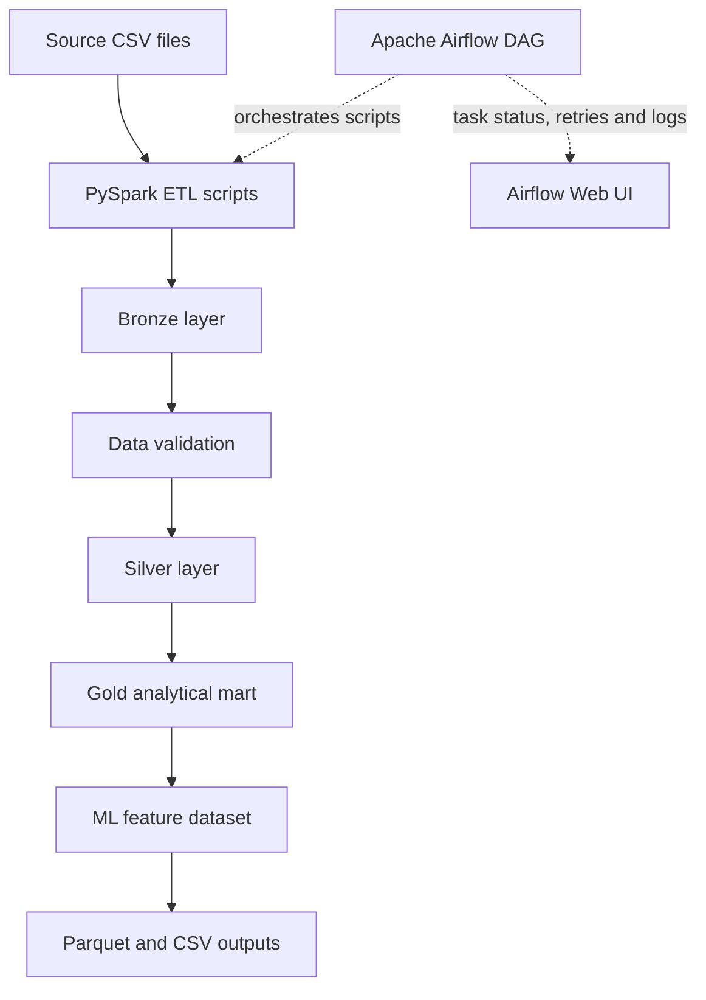

| Component | Role |
|---|---|
| Python | Implements ETL scripts and defines the Airflow DAG |
| PySpark | Reads, transforms, joins, validates and writes datasets |
| Apache Airflow | Orchestrates tasks, dependencies, retries and monitoring |
| Parquet | Stores intermediate and processed datasets |
| CSV | Provides a convenient export of the final feature dataset |

**Important distinction:** Airflow does not perform the Spark transformations. Airflow launches and monitors the scripts; PySpark performs the data processing.

## 3. Source datasets

| Source file | Description | Jharkhand records used |
|---|---|---:|
| `india-districts-census-2011.csv` | Census district demographics | 24 |
| `hlpca-total.csv` | Census district housing and household information | 24 |
| `RS_Session_256_AU_3148_1.csv` | NSAP pension information | 1 state-level record |

The two Census files contain 640 national records each. The pipeline selects the 24 Jharkhand district records from each. The supplied NSAP file contains a state-level Jharkhand record, not district-level beneficiary counts.

**Data limitation:** District-level NSAP beneficiary counts are not available in the supplied source. The pipeline does not distribute or estimate the state-level figure across districts. District-level pension beneficiary fields remain null, and the availability indicator is false.

## 4. ETL architecture and data layers

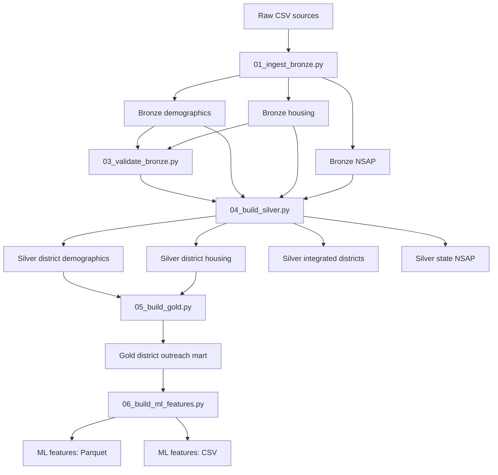

### 4.1 Bronze layer — ingestion

**Script:** `scripts/01_ingest_bronze.py`

The ingestion script reads the three source CSV files, filters the Census datasets for Jharkhand, and writes the resulting datasets in Parquet format.

Expected output structure:

```text
data/bronze/
├── demographics/
├── housing/
└── nsap/
```

The Bronze layer preserves the ingested source data in a structured format for subsequent processing.

### 4.2 Bronze validation

**Script:** `scripts/03_validate_bronze.py`

The validation script checks record counts, missing and duplicate district codes, district coverage between datasets, important null values, and consistency of district code/name mappings.

Observed validation results:

| Validation check | Result |
|---|---:|
| Demographic records | 24 |
| Housing records | 24 |
| Duplicate district codes | 0 |
| Missing district codes | 0 |
| District coverage mismatch | None |
| Null population values | 0 |
| Null household-count values | 0 |

These checks help identify structural problems before the datasets are integrated.

### 4.3 Silver layer — standardisation and integration

**Script:** `scripts/04_build_silver.py`

The Silver script:
- Standardises column names into lowercase underscore format.
- Casts district codes to a consistent string type.
- Prefixes overlapping housing columns to avoid naming conflicts.
- Joins demographic and housing records using district code.
- Keeps state-level NSAP information separate from district-level records.

Expected output structure:

```text
data/silver/
├── district_demographics/
├── district_housing/
├── district_integrated/
└── state_nsap/
```

The Silver layer provides cleaner and more consistent datasets for analytical processing.

### 4.4 Gold layer — analytical mart and priority score

**Script:** `scripts/05_build_gold.py`

The Gold script combines the Silver demographic and housing datasets and calculates indicators such as:

- Population per household
- Female population share
- Literacy rate
- Work participation rate
- SC and ST population shares
- Age-50-plus population share
- Housing and household indicators

The script normalises seven vulnerability components using min-max scaling and calculates a weighted priority score.

| Component | Weight |
|---|---:|
| Age | 0.25 |
| Housing | 0.20 |
| Social group | 0.15 |
| Literacy | 0.15 |
| Work participation | 0.10 |
| Household pressure | 0.10 |
| Female population | 0.05 |
| **Total** | **1.00** |

The resulting score is on a 0–100 scale. Districts are ranked and assigned to three priority categories using `ntile(3)`, producing 8 High, 8 Medium and 8 Low priority districts.

Output:

```text
data/gold/mart_district_pension_outreach/
```

**Interpretation:** This is a rule-based vulnerability proxy derived from available Census indicators. It is not a verified pension eligibility score, an observed enrolment outcome, or a direct measurement of unmet pension demand.

### 4.5 ML feature preparation

**Script:** `scripts/06_build_ml_features.py`

The ML feature script selects the feature columns from the Gold mart, creates `target_high_priority` (1 for High priority and 0 otherwise), retains priority category/rank/score fields, and writes Parquet and CSV outputs.

Expected output structure:

```text
data/ml/
├── ml_district_features/
└── ml_district_features_csv/
```

**Modelling caveat:** The target is derived from the rule-based Gold classification, not an independently observed outcome. A model trained to predict this target may simply reproduce the existing scoring rules. Feature selection must also avoid target leakage.

## 5. Airflow orchestration

The workflow is defined in:

`dags/district_pension_pipeline.py`

The DAG ID is `district_pension_pipeline`.

A **DAG (Directed Acyclic Graph)** is a workflow blueprint. It represents the tasks to execute and the dependencies between them.

### 5.1 DAG task flow

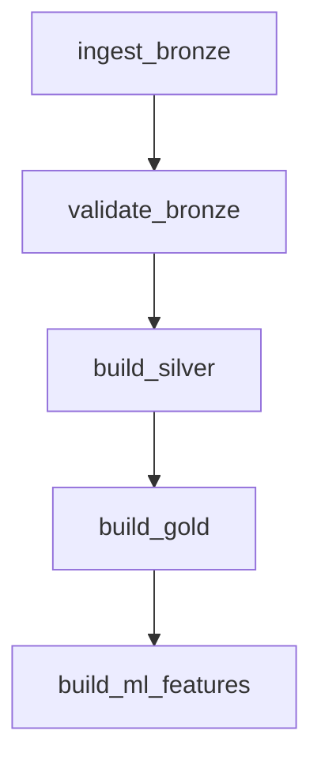

The dependency is expressed in the DAG code:

```python
ingest_bronze >> validate_bronze >> build_silver >> build_gold >> build_ml_features
```

This tells Airflow that each downstream task must wait for the upstream task to complete successfully.

### 5.2 How Airflow invokes PySpark

The DAG uses Airflow's `BashOperator`. Each task runs a shell command that:
1. Changes to the project directory.
2. Activates the project's Python virtual environment.
3. Sets the Java 17 environment variables.
4. Executes the relevant Python script.

Simplified example:

```python
ingest_bronze = BashOperator(
    task_id="ingest_bronze",
    bash_command="""
    cd /path/to/district-pension-pipeline
    source venv/bin/activate
    export JAVA_HOME=$(/usr/libexec/java_home -v 17)
    export PATH="$JAVA_HOME/bin:$PATH"
    python scripts/01_ingest_bronze.py
    """,
)
```

Airflow waits for the command to finish. A successful exit allows dependent tasks to proceed. A failed command marks the task as failed.

### 5.3 Retry configuration

The DAG defines:

```python
default_args = {
    "owner": "soham",
    "retries": 1,
    "retry_delay": timedelta(minutes=2),
}
```

This configures one retry after a two-minute delay if a task fails. Retries can help with temporary failures, but they do not resolve persistent code, configuration or data errors.

### 5.4 Scheduling configuration

The current DAG uses:

```python
schedule=None
catchup=False
```

This means the workflow is manually triggered and is not configured for recurring scheduled execution.

## 6. Airflow execution, monitoring and failure handling

### 6.1 Task execution lifecycle

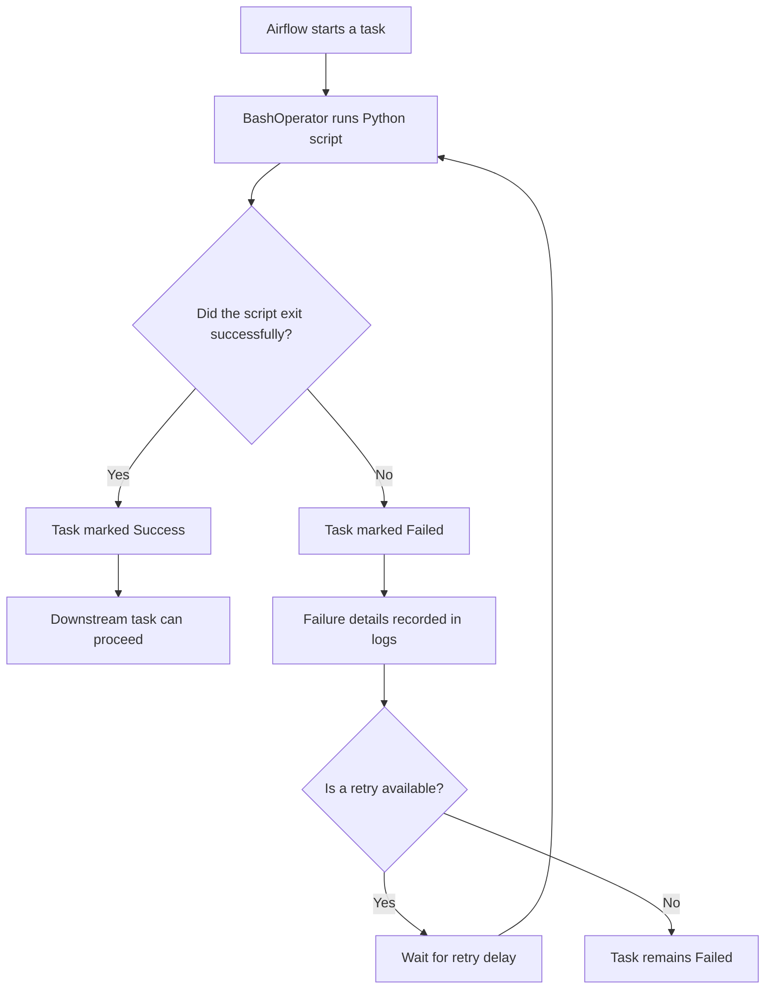

### 6.2 What the Airflow interface shows

| Airflow view | Purpose |
|---|---|
| DAG Graph | Visualises tasks and their dependencies |
| Grid / task instances | Shows task execution states |
| Runs | Lists individual workflow executions |
| Task logs | Shows command output, script messages and errors |
| Overview | Summarises workflow runs and task information |

Typical task states include:
- **Success:** Task completed successfully.
- **Failed:** Task execution ended with an error.
- **Running:** Task is currently executing.
- **Queued:** Task is waiting to be executed.
- **Upstream failed:** A required earlier task failed, so the downstream task could not proceed.

The UI makes it easier to identify where a pipeline stopped and inspect the logs for the reason.

## 7. Test execution and results

The complete DAG was tested from the terminal using:

```bash
airflow dags test district_pension_pipeline 2026-11-13
```

All five tasks completed successfully.

| Task | Execution result |
|---|---|
| `ingest_bronze` | Success |
| `validate_bronze` | Success |
| `build_silver` | Success |
| `build_gold` | Success |
| `build_ml_features` | Success |
| **Successful tasks** | **5** |
| **Failed tasks** | **0** |
| **Approximate total duration** | **46.4 seconds** |

The test confirmed that the scripts could execute in the configured sequence through the Airflow DAG.

**Testing note:** `airflow dags test` is a CLI test command. It is distinct from a normal DAG run triggered using the Airflow UI. If documenting a UI-triggered run, capture its run details separately.

### 7.1 Output directory verification

The pipeline generated the following data-layer directories:

```text
data/
├── bronze/
│   ├── demographics/
│   ├── housing/
│   └── nsap/
├── silver/
│   ├── district_demographics/
│   ├── district_housing/
│   ├── district_integrated/
│   └── state_nsap/
├── gold/
│   └── mart_district_pension_outreach/
└── ml/
    ├── ml_district_features/
    └── ml_district_features_csv/
```

Spark writes CSV output into a directory rather than directly into a single named CSV file. The `part-*.csv` file contains the exported records. The `_SUCCESS` file is a marker indicating that the Spark output write completed successfully.

## 8. Screenshot evidence

Use this section to document the actual Airflow interface and pipeline outputs. Save screenshots in a dedicated folder, for example:

```text
docs/
└── screenshots/
    ├── 01-airflow-dag-list.png
    ├── 02-dag-overview.png
    ├── 03-dag-graph.png
    ├── 04-successful-dag-run.png
    ├── 05-task-instances.png
    ├── 06-task-log.png
    ├── 07-bronze-validation.png
    ├── 08-gold-priority-output.png
    └── 09-ml-csv-output.png
```

Add the real screenshots to the folder, then use the following Markdown image syntax to display them.

### 8.1 DAG registration

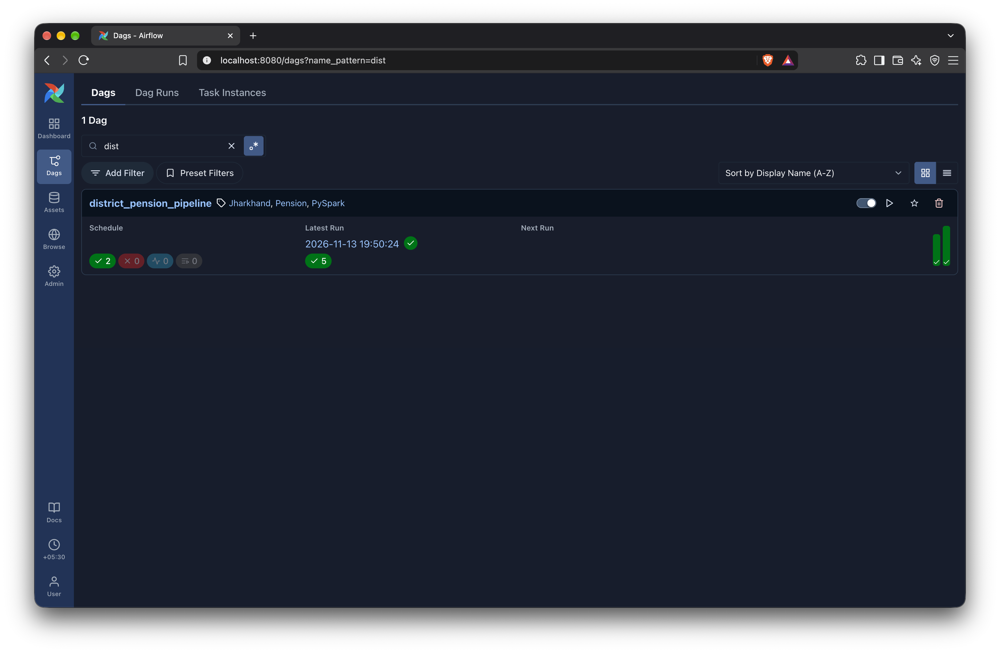

*Figure 1. The `district_pension_pipeline` DAG registered and discoverable in Airflow.*

### 8.2 DAG overview

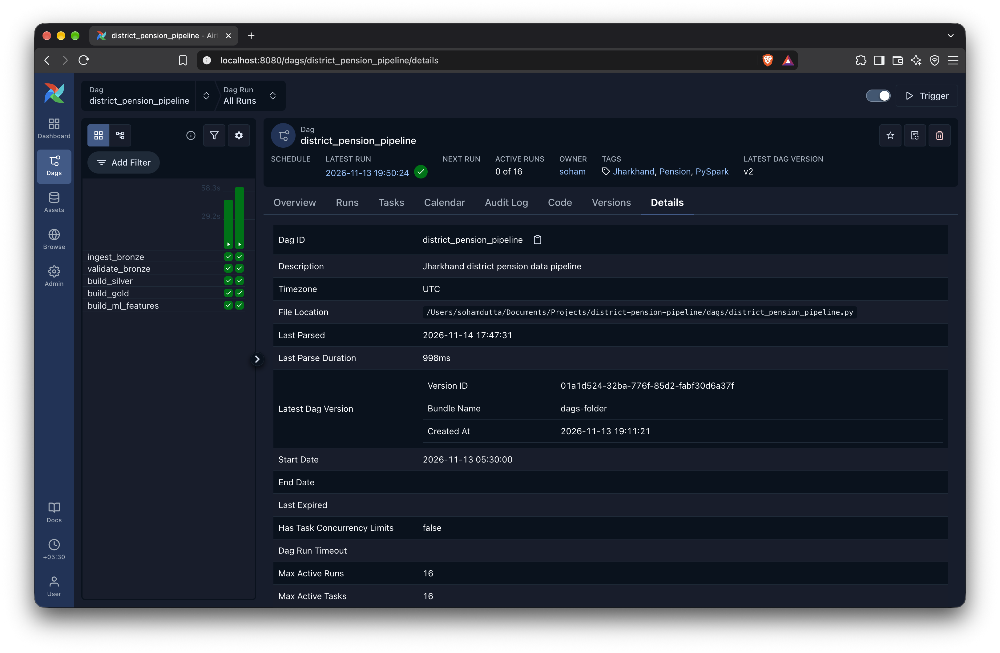

*Figure 2. Airflow overview showing the pipeline and its run information.*

### 8.3 DAG graph and task dependencies

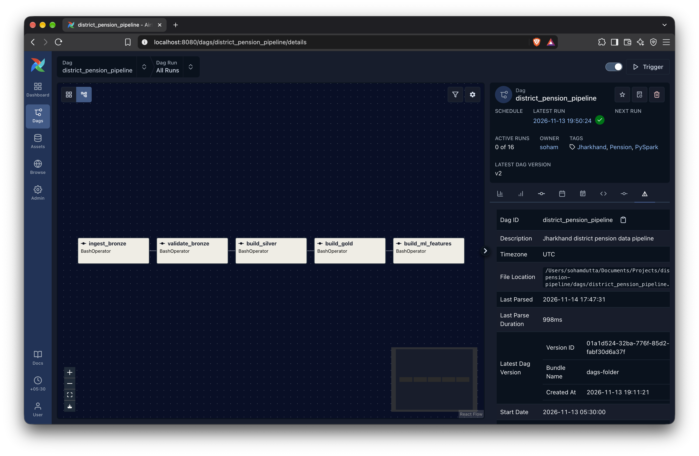

*Figure 3. Graph view showing the five tasks and their execution dependencies.*

### 8.4 Successful DAG execution

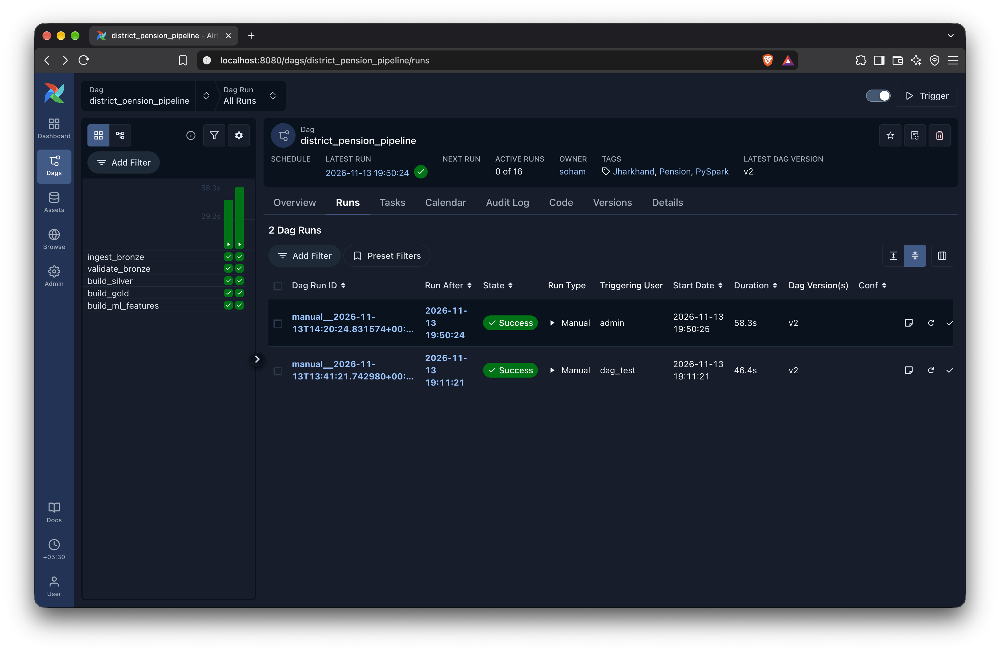

*Figure 4. Successful completion of the pipeline workflow.*

### 8.5 Individual task states

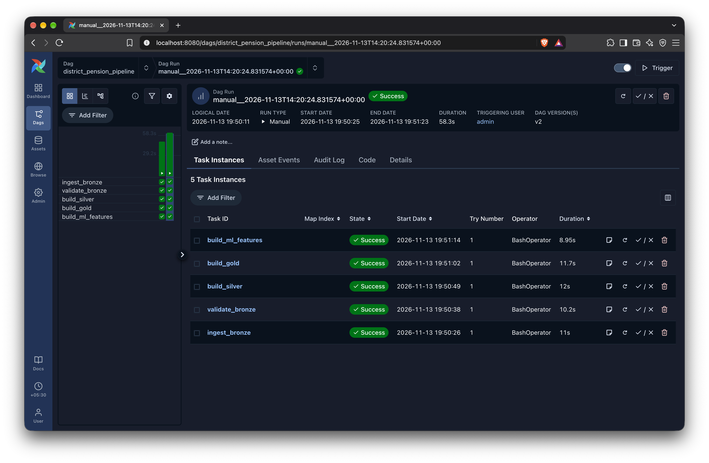

*Figure 5. Task instances showing the execution status of each pipeline stage.*

### 8.6 Task logs

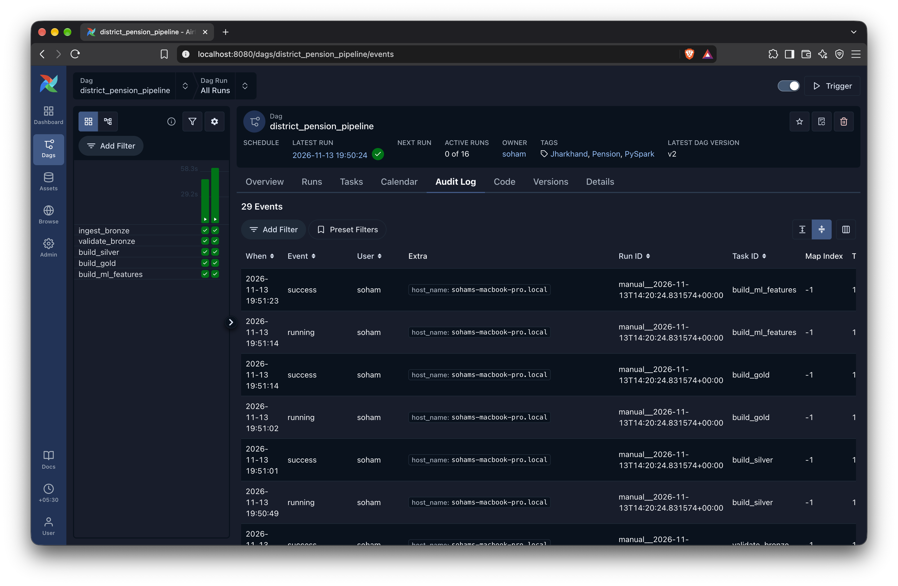

*Figure 6. Task logs showing the output produced during script execution.*

### 8.7 Bronze validation output

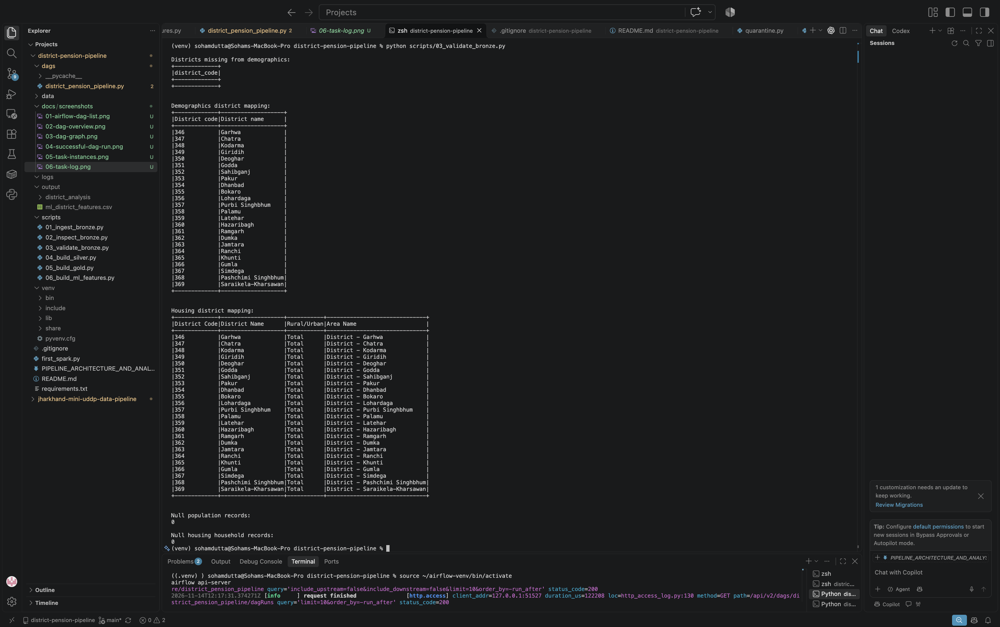

*Figure 7. Validation output confirming district record counts and data-quality checks.*

### 8.8 Gold analytical output

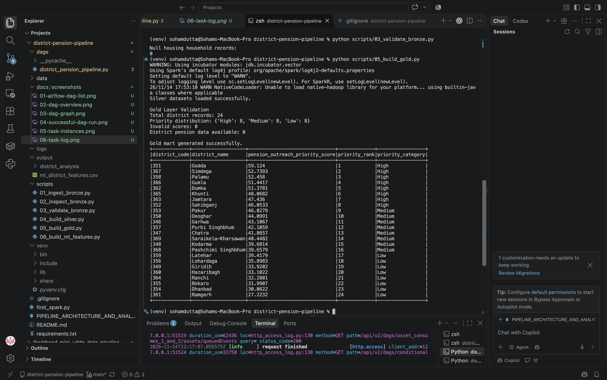

*Figure 8. Gold output containing district-level indicators, priority scores and categories.*

### 8.9 ML feature export

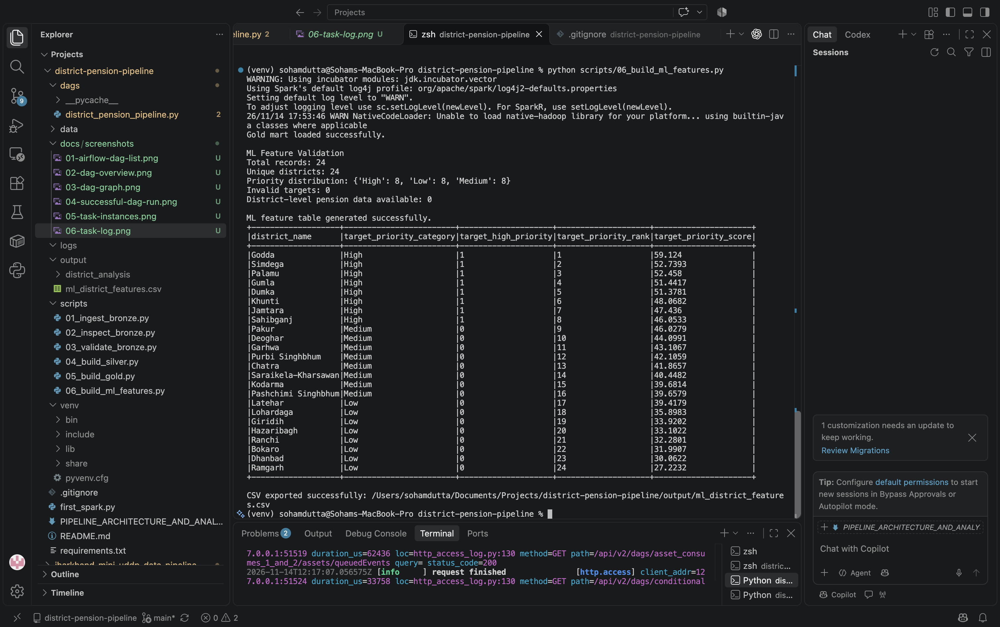

*Figure 9. Generated ML feature CSV output and Spark success marker.*

> Replace the image paths with the actual screenshot filenames if they differ. Remove any figure for which no screenshot has been captured; do not present placeholders as test evidence.

## 9. Running the project locally

### 9.1 Activate the project environment

```bash
cd ~/Documents/Projects/district-pension-pipeline
source venv/bin/activate
export JAVA_HOME=$(/usr/libexec/java_home -v 17)
export PATH="$JAVA_HOME/bin:$PATH"
```

### 9.2 Start Airflow services

Run each service in a separate terminal.

**Terminal 1 — API server**

```bash
source ~/airflow-venv/bin/activate
airflow api-server
```

**Terminal 2 — Scheduler**

```bash
source ~/airflow-venv/bin/activate
airflow scheduler
```

**Terminal 3 — DAG processor**

```bash
source ~/airflow-venv/bin/activate
airflow dag-processor
```

Open `http://localhost:8080`, locate `district_pension_pipeline`, and use the Trigger action to start a manual run. Keep the service terminals running while using the interface. Stop each service using `Ctrl+C`.

## 10. Quick concept reference

| Term | Plain-language explanation |
|---|---|
| ETL | Extract data, transform it, and load the result |
| DAG | Workflow blueprint describing tasks and dependencies |
| Task | One unit of work in an Airflow workflow |
| Operator | Airflow component that defines how a task performs work |
| BashOperator | Runs a shell command; in this project it launches a Python script |
| Scheduler | Determines when DAG runs and tasks should be scheduled |
| DAG processor | Parses DAG files so Airflow can discover workflow definitions |
| API server | Provides the Airflow web interface and API |
| PySpark DataFrame | Table-like structure used for distributed data processing |
| Parquet | Column-oriented file format commonly used for analytical datasets |
| Data validation | Checks data completeness, uniqueness and consistency |

## 11. Analytical limitations and considerations

1. **Census reference year:** The demographic and housing inputs are from Census 2011 and may not reflect current district conditions.
2. **NSAP data granularity:** The supplied NSAP source contains a state-level Jharkhand record, not district-level beneficiary counts.
3. **Missing district pension figures:** District-level pension beneficiary fields remain null rather than being estimated or allocated.
4. **Priority score interpretation:** The Gold score is a weighted vulnerability proxy, not a verified pension eligibility or beneficiary-demand measure.
5. **ML target definition:** The ML target is derived from the rule-based priority classification, not an independently observed outcome.

These limitations should be considered before using the outputs for policy decisions or training a predictive model.

## 12. End-to-end summary

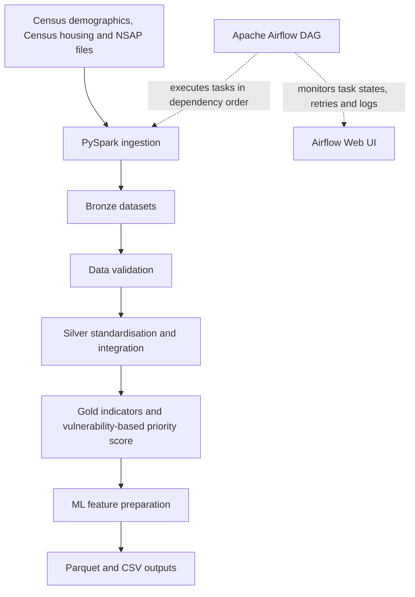

**Summary:** PySpark performs the data engineering work, from ingestion through transformation and feature preparation. Apache Airflow coordinates the scripts in the required order and provides a central interface to inspect workflow progress, task dependencies, execution results, failures and logs.
